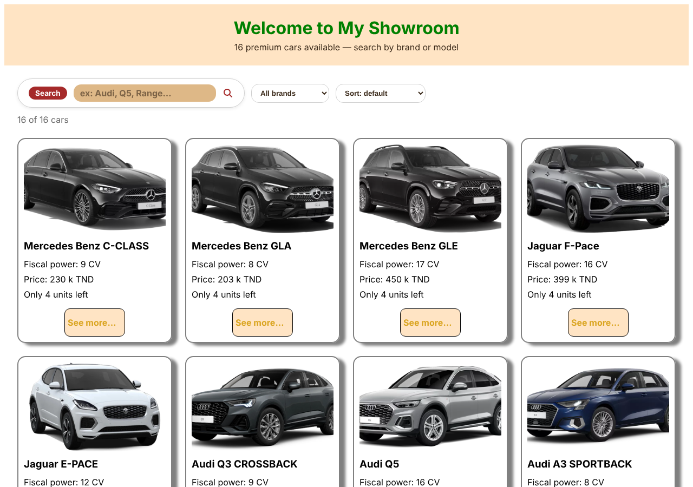
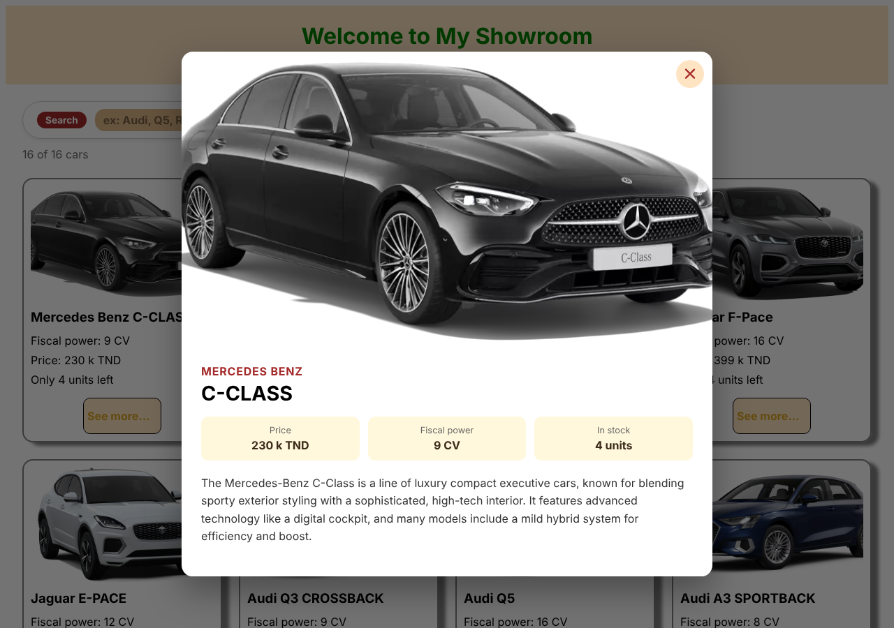

# 🚗 ShowroomAuto

A car showroom web app built with **Angular 22**. You can browse a catalogue of 16 premium cars (Mercedes-Benz, Audi, BMW, Jaguar, Land Rover and Alfa Romeo), search and filter them, sort them by price or power, and open a detail view for each model.



## Features

- **Live search** by brand *or* model (`audi`, `q5`, `range`…)
- **Brand filter** and **sorting** by price (ascending / descending) or fiscal power
- **Detail modal** with large photo, key specs and description. Close it with ✕, a click outside, or `Esc`
- **Low-stock highlight** when 3 units or fewer are left
- Empty-state message with a one-click "Clear filters" button
- Responsive grid layout



## Tech stack

| | |
|---|---|
| Framework | Angular 22 (standalone components, signals, new control flow `@if` / `@for`) |
| Language | TypeScript |
| Icons | Font Awesome (`@fortawesome/angular-fontawesome`) |
| Tests | Vitest via `ng test` |

## Getting started

Requires **Node.js 20+** and npm.

```bash
git clone https://github.com/YusfAI/Angular.git
cd Angular
npm install
npm start          # http://localhost:4200
```

Other commands:

```bash
npm run build      # production build in dist/showroom-auto
npm test           # unit tests
```

## Project structure

```
src/app/
├── app.ts / app.html            # root component: holds the catalogue and the selected car
├── data/cars.ts                 # car catalogue (16 models)
├── interface/auto.ts            # Auto type
└── components/
    ├── head-bar/                # page header
    ├── search-bar/search-bar/   # search, brand filter, sorting, car grid
    └── car-detail/              # detail modal
public/images/                   # car photos (.webp)
```

## Data model

```ts
interface Auto {
  id: number;
  brand: string;
  model: string;
  price: number;        // thousands of TND
  power: number;        // fiscal horsepower (CV)
  photo: string;        // file name in public/images
  availability: number; // units in stock
  description: string;
}
```

To add a car, append an entry to `src/app/data/cars.ts` and put its photo in `public/images/`.

## Possible next steps

- Load the catalogue from a REST API instead of a static file
- Add routing (`/cars/:id`) so a car can be shared by URL
- Reservation / test-drive request form

## Author

**Youssef**, Business Intelligence student at IHEC Carthage · [GitHub](https://github.com/YusfAI)
